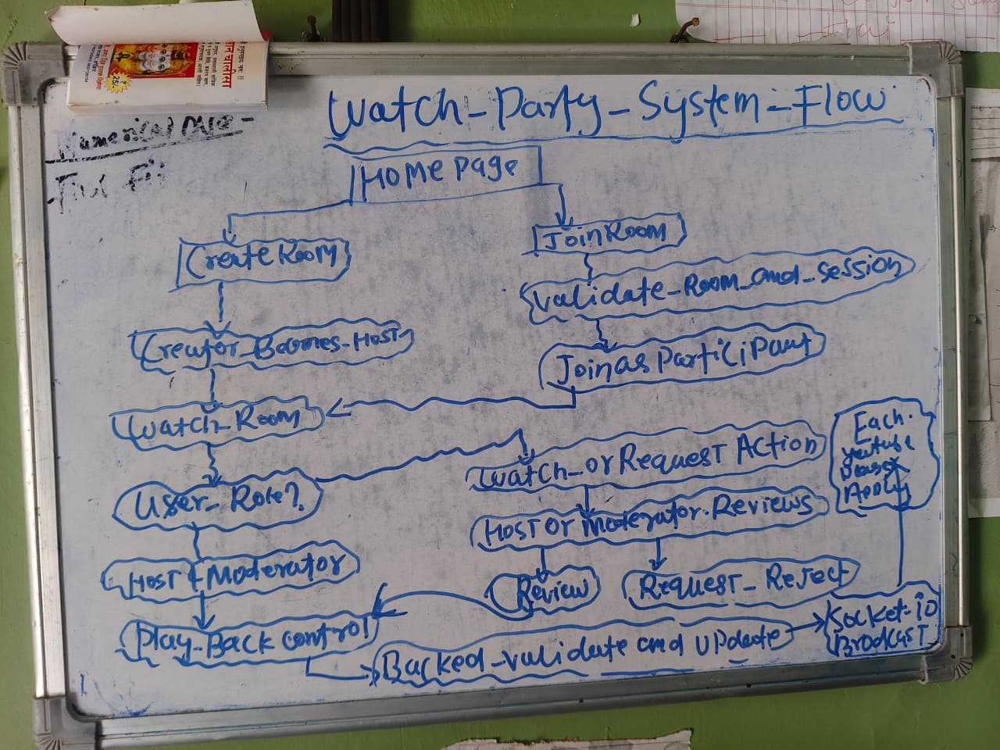

#  YouTube Watch Party

**Watch YouTube together, in real time — from anywhere.**

A real-time collaborative YouTube viewing platform that lets users create rooms, invite friends, synchronize video playback, and chat together. Built with Socket.IO, Next.js, Node.js, and PostgreSQL, with role-based access control for a collaborative viewing experience.

## 🚀 Live Demo

| Service | Link |
|---|---|
| **Frontend** | [WatchParty Web App](https://watchparty-qzjv.vercel.app/) |
| **Backend API** | [WatchParty Backend](https://watchpartybacked.onrender.com/) |
| **Health Check** | [Check Backend Status](https://watchpartybacked.onrender.com/health) |

## ✨ Features

- **Real-Time Video Synchronization** — Synchronize playback actions such as play, pause, and seeking across participants.
- **Room-Based Viewing** — Create or join watch rooms using unique room codes.
- **Role-Based Access Control** — Three roles: Host, Moderator, and Participant.
- **Request & Approval Workflow** — Support a controlled workflow for participant requests and approvals.
- **Real-Time Communication** — Socket.IO enables event-based communication between connected users.
- **Live Chat** — Chat with other participants while watching together.
- **JWT Authentication** — Token-based authentication for protected application functionality.
- **YouTube Integration** — Embed and control YouTube videos using the YouTube IFrame Player API.

## 🛠️ Tech Stack

| Layer | Technologies |
|---|---|
| Frontend | Next.js 16, TypeScript |
| Styling | Tailwind CSS |
| Real-Time Communication | Socket.IO, Socket.IO Client |
| Backend | Node.js, Express.js |
| Database | PostgreSQL |
| ORM | Prisma |
| Authentication | JSON Web Tokens (JWT) |
| Video Player | YouTube IFrame Player API |
| Deployment | Vercel, Render |
| Version Control | Git, GitHub |

## 🏗️ Architecture

The application follows a modular, full-stack architecture:

- **Frontend:** Provides the user interface for authentication, watch rooms, video playback, and chat.
- **Backend:** Handles API requests, room operations, authentication, and real-time events.
- **Socket.IO:** Transmits playback and chat events between users in a room.
- **PostgreSQL + Prisma:** Store and manage application data.

For more implementation details, see [`ARCHITECTURE.md`](./ARCHITECTURE.md).

## 📂 Project Structure

```text
watchparty/
├── apps/
│   ├── web/          # Next.js frontend
│   └── server/       # Node.js + Express backend
├── packages/
│   └── types/        # Shared TypeScript types
├── package.json
└── ARCHITECTURE.md
```

## ⚙️ Getting Started

### Prerequisites

Make sure you have the following installed:

- Node.js (compatible with the project's dependencies)
- npm
- PostgreSQL database
- Git

### 1. Clone the Repository

```bash
git clone https://github.com/rahulkumar919/watchparty.git
cd watchparty
```

### 2. Install Dependencies

```bash
npm install
```

### 3. Configure Environment Variables

Configure the environment variables required by the backend and frontend. Add your database connection string, JWT secret, and other required settings to the appropriate `.env` files.

**Important:** Check the project's environment configuration or documentation for the exact variable names. Never commit secrets or production credentials to GitHub.

### 4. Generate the Prisma Client

```bash
npm run db:generate --workspace=apps/server
```

### 5. Run Database Migrations

```bash
npm run db:migrate --workspace=apps/server
```

Run migrations only against a correctly configured development database. For an existing production database, follow the project's migration and baseline procedure.

### 6. Start the Backend

```bash
npm run dev --workspace=apps/server
```

### 7. Start the Frontend

Open a separate terminal from the project root:

```bash
npm run dev --workspace=apps/web

## Tech Stack
Frontend: Next.js 16, TypeScript, Socket.IO Client
Backend: Node.js, Express, Socket.IO, Prisma, PostgreSQL

## Contact
Developer: Rahul Kumar
Email: hr@web3task.com
GitHub: @rahulkumar919

## 📊 Application Flow



*Visual diagram showing the complete user journey from home page to synchronized viewing*

